# SpA-Sentinel

[](https://colab.research.google.com/github/Muthuuk/SpA-Sentinel/blob/main/notebooks/SpA_Sentinel_Demo.ipynb)


**An AI agent that helps the care team look after people with ankylosing spondylitis (AS): it forecasts flares, stops a raised CRP being misread as an infection (or an infection being missed), and watches for the disease spreading to the gut, bladder and kidneys.**

Companion code for the ABH 2027 paper:

> Pandit, H. and Ramachandran, M. (2027) *AI Agents for Predicting Ankylosing Spondylitis Flares and Extra-Spinal Spread*. ABH 2027, Rome.

> **Research and teaching demonstrator only.** All data are synthetic. This software is not a medical device and must not be used to make decisions about real patients.

---

## Contents

1. [The problem in plain words](#the-problem-in-plain-words)
2. [How SpA-Sentinel works](#how-spa-sentinel-works)
3. [Screenshots](#screenshots)
4. [Run it](#run-it)
5. [Tools built for this study](#tools-built-for-this-study)
6. [Datasets](#datasets)
7. [Results on the synthetic data](#results-on-the-synthetic-data)
8. [Repository layout](#repository-layout)
9. [Authors, citation and licence](#authors-citation-and-licence)

---

## The problem in plain words

AS is a long-term inflammatory disease of the spine. It often affects other organs too: the gut (inflammatory bowel disease), the eyes (uveitis) and the kidneys. Three everyday problems motivated this work:

- **Flares come without warning.** A flare is a period of worse pain and stiffness. If the team could see one coming a week or two ahead, they could act earlier.
- **CRP is easy to misread.** CRP is a blood test that rises with inflammation. It rises in an AS flare *and* in an infection. Some people with AS run a high CRP even when they are well. In A&E, a CRP of 36 mg/L can lead to antibiotics that were not needed, or the opposite: an infection put down to "just your AS". People on biologic drugs are at higher risk of infection, so the stakes are high both ways.
- **Spread to other organs is found late.** New gut or kidney problems are often picked up only after they cause harm.

## How SpA-Sentinel works

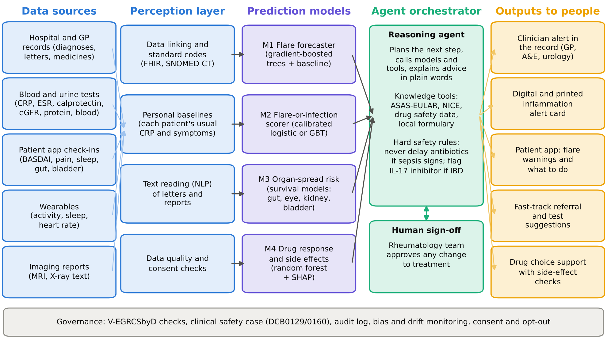

The agent has four layers. Each one is simple enough to check by hand.

**1. Personal baseline.** For every patient the agent keeps a note of *their own* usual CRP when well and when flaring (for example, 6 mg/L in remission and about 32 mg/L in a flare). A new result is judged against that person's normal, not against a single "normal range" for everyone.

**2. Four prediction models.** Each answers one clear question:

| Model | Question it answers | Method | Why this method |
|---|---|---|---|
| **M1** Flare forecaster | Will this patient flare in the next 14 days? | XGBoost on weekly symptom, activity and sleep scores | Copes well with mixed, messy weekly data |
| **M2** Flare-or-infection scorer | Is this raised CRP more likely a flare or an infection? | Calibrated logistic regression | Easy to explain; its probabilities can be trusted |
| **M3** Organ-spread risk | What is the risk of new IBD or kidney problems over 12 months? | Cox survival models (lifelines) | Built for "how long until X happens" questions |
| **M4** Drug response | How likely is a good response to a TNF-inhibitor at 12 weeks, and why? | XGBoost with SHAP explanations | SHAP shows which factors pushed the estimate up or down |

M2 uses **three bands** rather than a yes/no answer. The safety threshold is set so that about 98 in every 100 infections are flagged:

| M2 result | What the agent says |
|---|---|
| Above the 90%-sensitivity cut-off | **Infection likely** – look for a source and treat |
| Between the two cut-offs | **Uncertain** – take cultures before any antibiotic |
| Below the 98%-sensitivity cut-off | **Inflammatory flare more likely** – still check the safety rules |

**3. Hard safety rules (outside the models).** Written in plain Python in `spa_sentinel/rules.py`, so a clinician can read every one. They always win over the models:

| Rule | When it fires | Effect |
|---|---|---|
| SEPSIS (STOP) | 2 or more sepsis signs, or systolic BP below 100 | "Follow the sepsis pathway now. Do not delay antibiotics." Overrides any model result |
| BIOLOGIC (WARN) | Patient takes a biologic or targeted drug | Same-day review and cultures |
| UTI_SIGNS (WARN) | Positive urine nitrites with urinary symptoms | Urinary infection likely; send a urine culture |
| KIDNEY (WARN) | Blood or protein in the urine | Check urine protein:creatinine ratio and eGFR |
| IBD_IL17 (WARN) | Patient has IBD | IL-17 inhibitors not preferred |
| NSAID_KIDNEY (WARN) | eGFR below 60 | Limit anti-inflammatory painkillers |
| TB_SCREEN (STOP) | No TB or hepatitis B screen recorded | Screen before any biologic |

**4. Human sign-off.** The agent never prescribes. It writes a short summary in plain English, and any change to treatment needs sign-off by the rheumatology team. An optional step can reword the summary with a language model (Claude), but it cannot change any number or rule outcome.

### The care loop

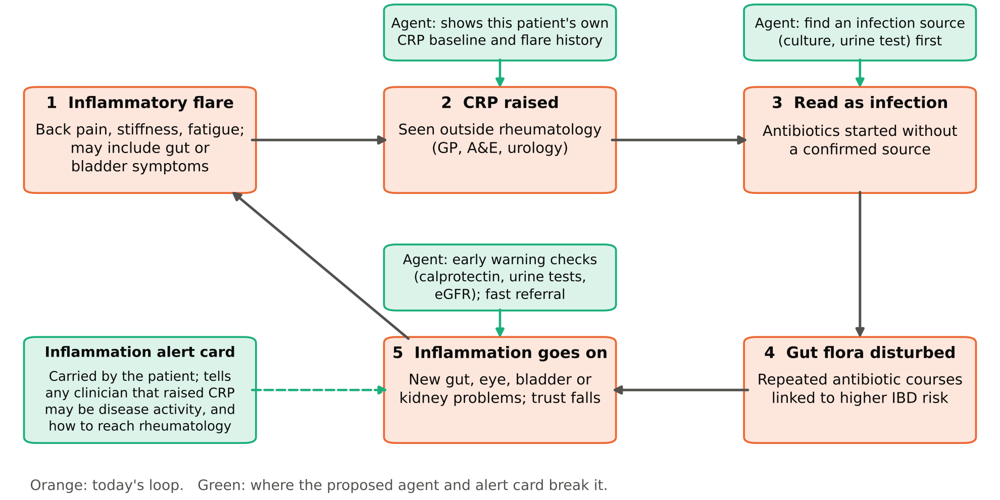

Weekly check-ins feed M1. A raised CRP (from A&E, the GP or the clinic) triggers M2 and the safety rules. M3 runs at each clinic review. M4 runs when a biologic is being chosen. Every output goes to a person, not straight to the patient's treatment.

### A worked example

Patient A is 41, on a TNF-inhibitor, and arrives with a CRP of 36 mg/L, a temperature of 37.1 °C, a normal heart rate and some blood in the urine. Their usual CRP is 6 mg/L when well and about 32 mg/L in a flare.

- **Baseline:** 36 mg/L is within this patient's usual flare range.
- **M2:** infection probability 0.14. That is above the 98% safety cut-off (0.02), so the answer is **"Uncertain – take cultures before any antibiotic"**, not "it's just your AS".
- **Rules:** BIOLOGIC and KIDNEY warnings fire. No sepsis signs.
- **M3:** 12-month risk of new IBD 3.1%, kidney involvement 4.4%.
- **M4:** chance of TNF-inhibitor response 0.56. Higher CRP raised the estimate; higher body mass index lowered it.

If the same patient instead had a temperature of 38.9 °C, a heart rate of 118 and a white count of 15.8, the SEPSIS rule fires and overrides everything (screenshot 2).

## Screenshots

All screenshots are real output from the code in this repository, made with `tools/make_screenshots.py`.

**1. The agent's summary for Patient A** (`python -m spa_sentinel.cli demo`)

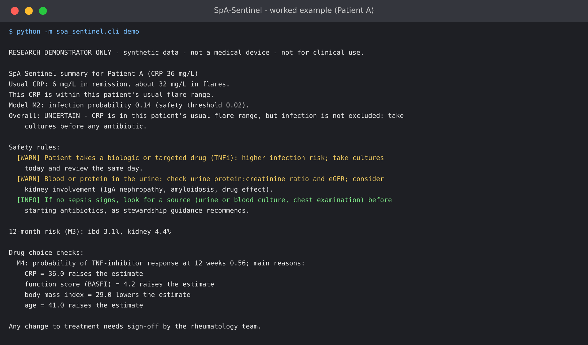

**2. Safety rule overriding the model** – the same patient with signs of sepsis. The rule wins, whatever the model says.

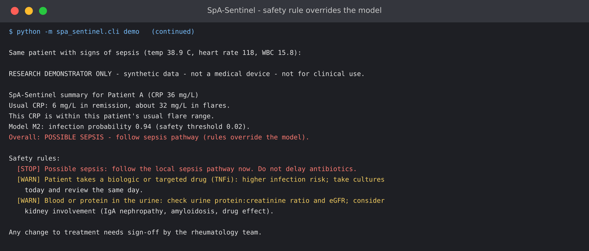

**3. Model scores on held-out patients** (`python -m spa_sentinel.cli metrics`)

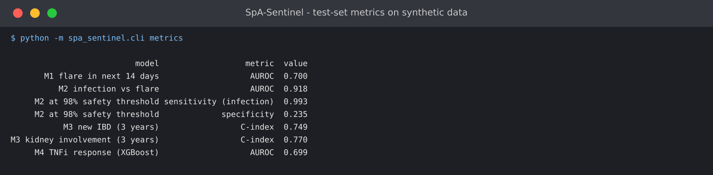

**4. ROC curves and calibration.** The ROC curve shows how well each model separates the two groups (top-left is best). The calibration plot checks that "30% risk" really means about 30 out of 100.

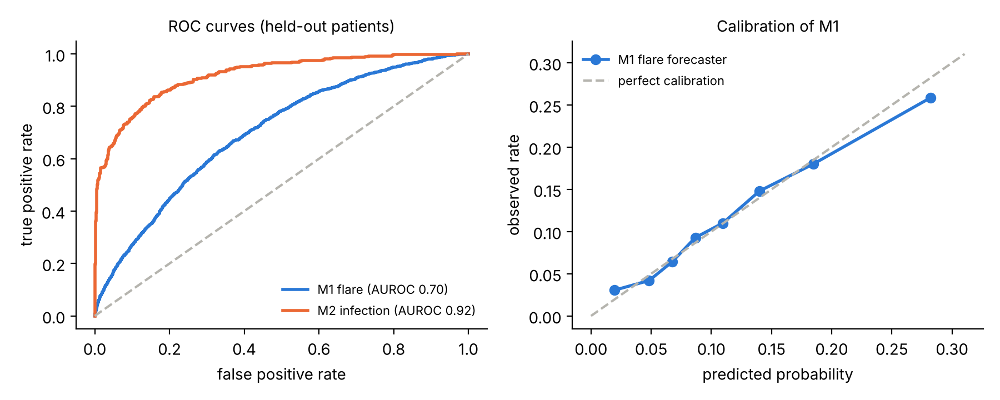

**5. The M2 safety trade-off.** Catching more infections means clearing fewer flares. At the 98% target, 99 in 100 infections are caught but only 23 in 100 flares are cleared, so more patients get cultures first. The paper argues this is the right price for safety.

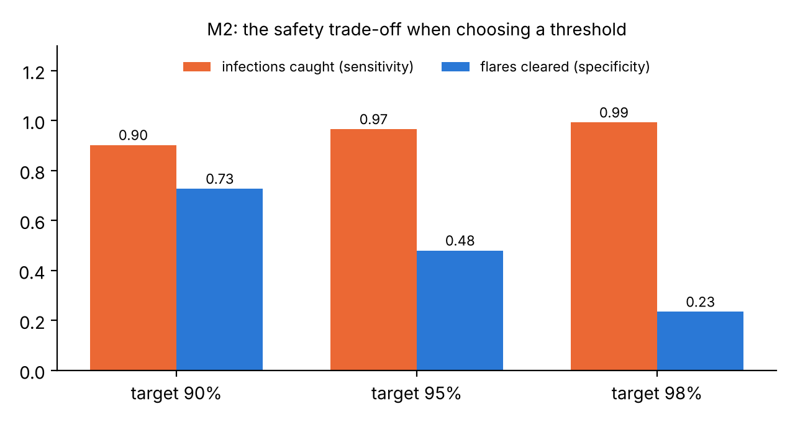

**6. What drives the M4 drug-response estimate (SHAP).** Each dot is one patient. Dots to the right raised the estimate; red means a high value of that factor. High CRP raises the chance of response; high BMI lowers it.

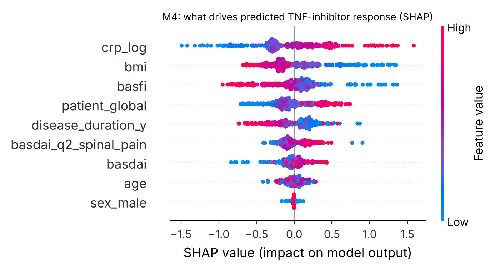

**7. M3 survival model for new IBD.** Points to the right of the dashed line raise the risk. Faecal calprotectin (a stool test for gut inflammation) is the strongest signal.

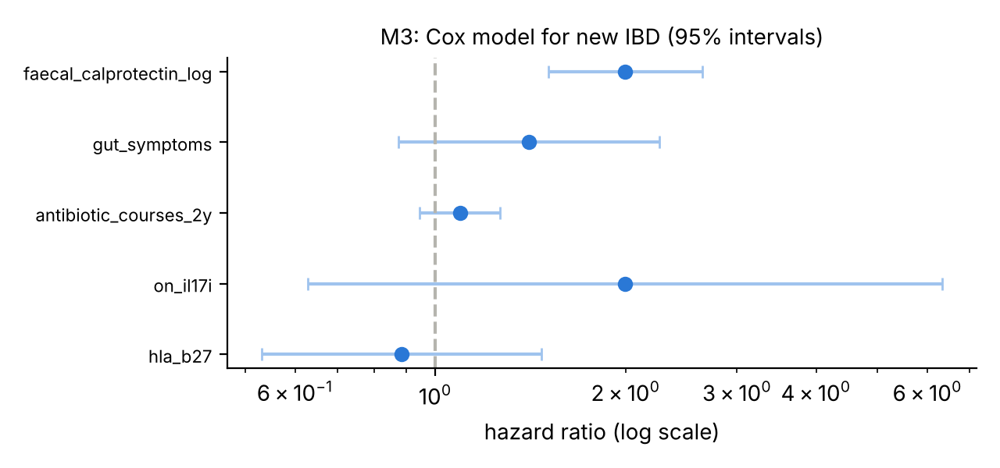

**8. Patient inflammation alert card** (`python -m spa_sentinel.cli card ...`). A wallet card the patient can show in A&E, giving their usual CRP so staff do not misread a raised result.

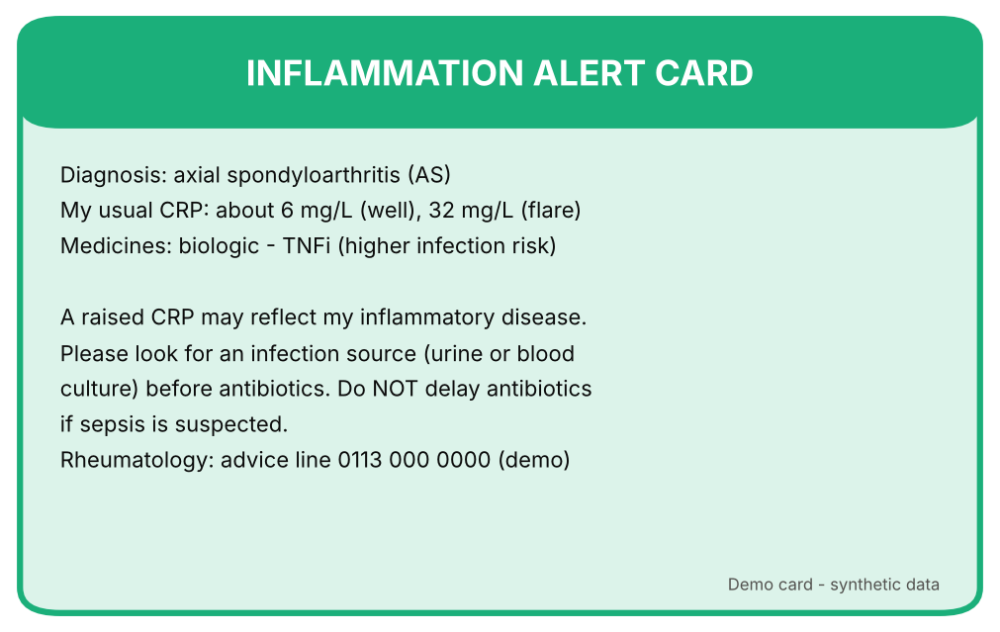

**9. Return-on-investment calculator** (`python -m spa_sentinel.cli roi`)

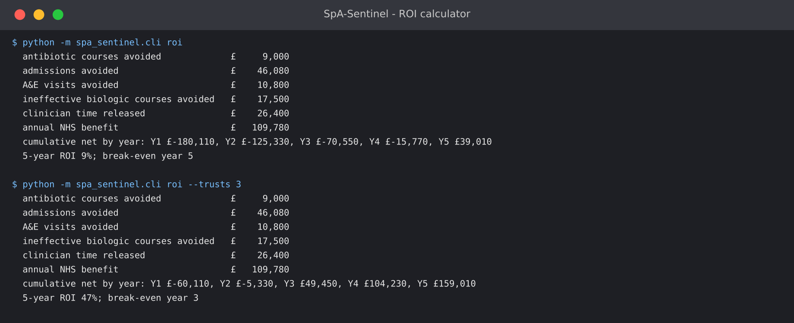

## Run it

**In Google Colab (no install):** click the badge at the top and choose *Runtime > Run all*. The first cell installs the libraries and clones this repository. The whole notebook runs in about a minute.

**Locally:**

```bash
git clone https://github.com/Muthuuk/SpA-Sentinel.git
cd SpA-Sentinel
pip install -r requirements.txt
pytest -q tests                                 # 7 safety-rule and ROI tests
python -m spa_sentinel.cli demo                 # worked example (trains models on first run, ~10 s)
jupyter notebook notebooks/SpA_Sentinel_Demo.ipynb
```

## Tools built for this study

| Tool | Command | What it does |
|---|---|---|
| **Agent CLI – demo** | `python -m spa_sentinel.cli demo` | Runs the Patient A worked example and the sepsis override |
| **Agent CLI – assess** | `python -m spa_sentinel.cli assess --crp 36 --remission 6 --flare 32 --temp 37.1 --biologic TNFi --urine-blood` | Assesses a raised CRP for any (synthetic) patient you describe |
| **Agent CLI – metrics** | `python -m spa_sentinel.cli metrics` | Prints held-out scores for M1–M4 |
| **ROI calculator** | `python -m spa_sentinel.cli roi [--trusts 3]` | Five-year cost–benefit model from the paper (Table 5); change the assumptions in `spa_sentinel/roi.py` |
| **Alert-card maker** | `python -m spa_sentinel.cli card --remission 6 --flare 32 --biologic TNFi --out card.png` | Makes a printable patient inflammation alert card |
| **Synthetic data generator** | `python -m spa_sentinel.data_gen` | Rebuilds the five CSV files in `data/` |
| **Paper figure builder** | `python tools/paper_figures.py --dpi 600` | Redraws Figures 1–5 of the paper at any resolution into `docs/figures/` |
| **Screenshot builder** | `python tools/make_screenshots.py [--dpi 600 --out folder]` | Regenerates every screenshot in this README from live output, at any resolution |
| **Demo notebook** | `notebooks/SpA_Sentinel_Demo.ipynb` | End-to-end walk-through: data, models, rules, agent, explanations, ROI |
| **Tests** | `pytest -q tests` | Checks that the safety rules behave as designed and the ROI matches the paper |

## Datasets

All five CSV files in `data/` are **synthetic**, produced by `spa_sentinel/data_gen.py` (fixed seed). No real patient data are used. The relationships follow the direction of effects reported in the literature cited in the paper; the sizes of the effects are illustrative only.

| File | Rows | Content | Used by |
|---|---|---|---|
| `patients.csv` | 1,200 | Age, sex, HLA-B27, disease length, personal CRP baselines, biologic treatment | all |
| `weekly.csv` | about 50,000 | Up to 52 weeks of check-ins per person; label: flare in the next 14 days | M1 |
| `crp_episodes.csv` | 6,000 | Raised-CRP episodes with vital signs, urine tests and likely site; label: infection or flare | M2 |
| `organ_spread.csv` | 1,200 | Time to new IBD and kidney involvement over 3 years | M3 |
| `tnfi_starts.csv` | 1,500 | TNF-inhibitor starts; label: response at 12 weeks | M4 |

The infection and flare groups in `crp_episodes.csv` deliberately overlap (fever, heart rate, white count and symptom site), so M2 has a realistic, not trivial, task. For real-world testing, suitable data would come from rheumatology registries (for example BSRBR-AS in the UK) or linked hospital and GP records, with the necessary approvals.

## Results on the synthetic data

Held-out test sets; where a person appears more than once, the split is by patient so nobody is in both training and test data.

| Model | Measure | Value |
|---|---|---|
| M1 flare in next 14 days | AUROC | 0.70 |
| M2 infection vs flare | AUROC | 0.92 |
| M2 at 98% safety threshold | sensitivity / specificity | 0.99 / 0.24 |
| M2 at 90% threshold | sensitivity / specificity | 0.90 / 0.73 |
| M3 new IBD | C-index | 0.75 |
| M3 kidney involvement | C-index | 0.77 |
| M4 TNF-inhibitor response | AUROC (XGBoost / logistic) | 0.70 / 0.69 |

*AUROC and C-index run from 0.5 (coin toss) to 1.0 (perfect).* These numbers show that the pipeline works end to end; they say nothing about performance on real patients.

**ROI (from the paper's assumptions):** about £110k of NHS benefit a year. A single trust breaks even in year 5 (five-year ROI 9%); three trusts sharing the build break even in year 3 (ROI 47%).

## Repository layout

```
spa_sentinel/
  data_gen.py   synthetic data generator
  models.py     M1–M4 training, thresholds, SHAP, calibration
  rules.py      hard safety rules (sepsis, kidney, IBD, TB, NSAIDs ...)
  agent.py      SpASentinel agent: combines baseline, models and rules
  card.py       patient alert-card maker
  roi.py        return-on-investment model
  cli.py        command-line tool (demo, assess, metrics, roi, card)
data/           synthetic CSV files
docs/figures/   paper figures (regenerate with tools/paper_figures.py)
docs/screenshots/  README screenshots (regenerate with tools/make_screenshots.py)
notebooks/      SpA_Sentinel_Demo.ipynb
tests/          test_rules.py
tools/          paper_figures.py, make_screenshots.py
```

## Authors, citation and licence

- **Prof Hemant Pandit** – Leeds Institute of Rheumatic and Musculoskeletal Medicine (LIRMM), University of Leeds, Chapel Allerton Hospital, Leeds, UK
- **Prof Muthu Ramachandran** – Forti5 Technologies Ltd, UK, and CAIDS, School of Computing, University of South Africa ([ORCID 0000-0002-5303-3100](https://orcid.org/0000-0002-5303-3100)) – maintainer

```bibtex
@inproceedings{pandit2027spasentinel,
  author    = {Pandit, Hemant and Ramachandran, Muthu},
  title     = {AI Agents for Predicting Ankylosing Spondylitis Flares and Extra-Spinal Spread},
  booktitle = {Proceedings of ABH 2027},
  year      = {2027},
  note      = {Code: https://github.com/Muthuuk/SpA-Sentinel}
}
```

Code: MIT (see `LICENSE`). Synthetic data: free to reuse with attribution. Not a medical device.
